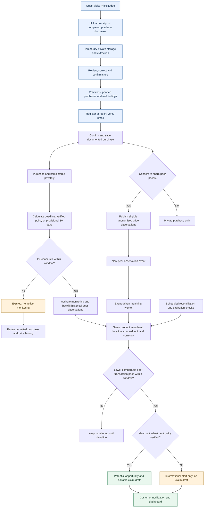
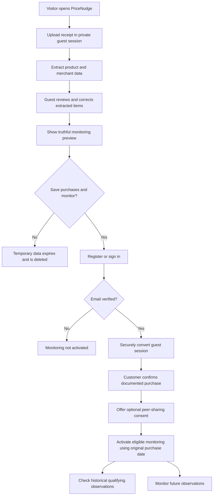
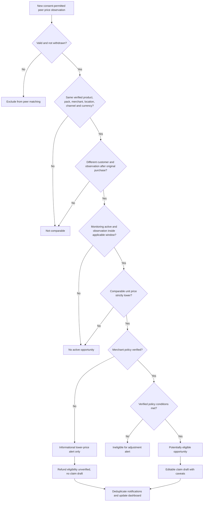
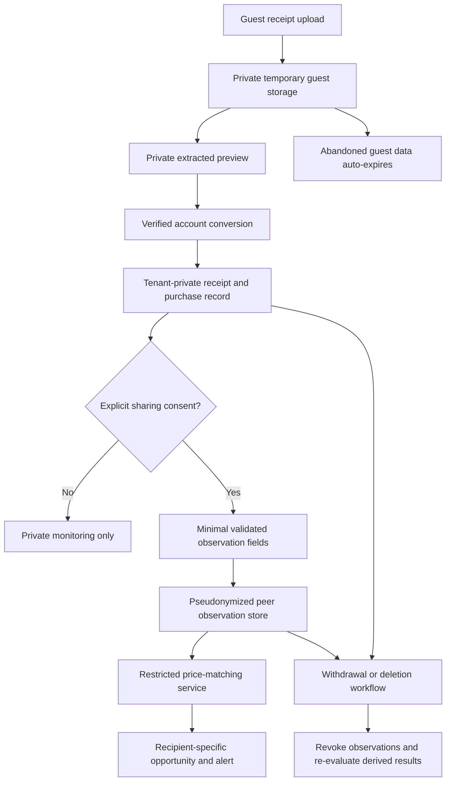
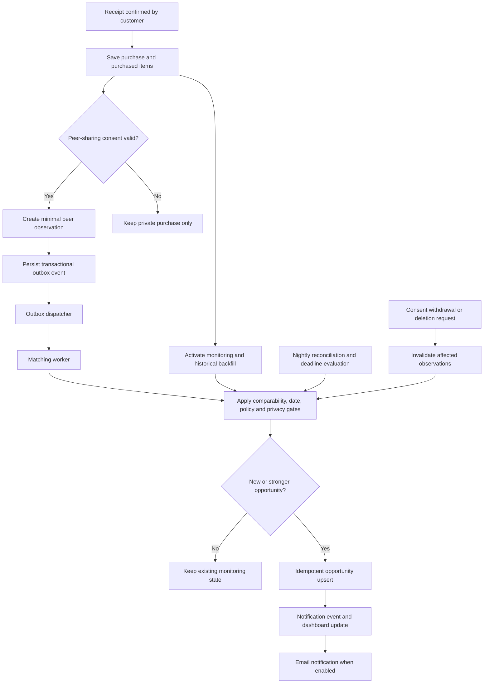

# PriceNudge

*Prices drop. We'll let you know.*
## Version 1 — Functional and Technical Specification (Bullet Edition)

**Version:** 1.3 (Bullet edition; incorporates the author's October 29 edits and approved claim-draft clarification)  
**Date:** 29 October 2026  
**Status:** Draft implementation design based on agreed use-case scope  
**Scope:** Peer-powered post-purchase price discovery; no retailer integrations, scraping, automatic submissions, or cross-location matching in V1.

> **v1.3 change note:** Reorganized the existing PriceNudge v1.2 requirements into concise bullets, grouped acceptance checks, and scan-friendly summaries. No product scope, monitoring rules, or privacy decisions were intentionally changed.

> **Reading guide:** Items marked **AGREED** are decisions from the use-case review. Items marked **PROPOSED** are engineering recommendations that need confirmation before implementation. A lower observed transaction price is evidence of a peer price, not proof of a current offer or a guaranteed adjustment.

# 1. Executive summary and release boundaries

**What PriceNudge delivers in V1**

- **Try before registering:**
  1. Guests upload a receipt or completed online purchase document.
  2. Correct extracted details if required.
  3. See an authentic preview.
- **Register to monitor:** Verified customers save confirmed purchases and activate monitoring.
- **Opt in to sharing:** Consenting customers contribute to privacy-controlled peer-price observations.
- **Find lower prices:** Compare the same product within the purchase eligibility window, matching:
  1. Merchant
  2. Store or storefront
  3. Purchase channel
  4. Currency
- **Notify and assist:** When a lower comparable price is found within the monitoring window, estimate potential savings and notify the customer. Generate an editable price-adjustment request **only if the merchant's adjustment policy is verified**.
- **Avoid overstating claims:** If the merchant's price-adjustment policy is unknown, send **an informational lower-price alert only**, clearly stating refund eligibility and current price availability are unverified. **Do not generate a claim draft**.
- **Show progress:** Track basic claim outcomes and historical peer transaction prices.

**AGREED — V1 release rules**

- **Receipt-first onboarding:** Guest visitors may upload and review qualifying receipt evidence. They can see a monitoring preview before account registration. Registration and email verification are required before saving purchases and activating monitoring. The customer must record a sharing-consent choice before contributing any peer observation. Never fabricate savings in previews to incentivize registration.
- Purchases require supporting receipt evidence. Users may correct extracted fields, not create unsupported purchases.
- Only same physical store or same regional online storefront and same purchase channel can match. A store pickup order placed online is an online purchase, with pickup site stored separately.
- All date comparisons use the *original purchase transaction timestamp*, not receipt upload time. A peer's transaction must occur after the original transaction and within the original purchase's eligibility period.
- A verified merchant adjustment policy supplies the monitoring window. If unknown, use a **provisional 30-day window beginning at purchase**, with informational alerts labeled *refund eligibility unverified*.
- Late uploads backfill already-ingested peer observations. No actionable claim alert after the customer's applicable window has expired; historical prices can remain visible.
- Basic quantities and straightforward price discounts may be normalized. Complex multi-buy conditions, unusual quantities and uncertain allocations are excluded from automatic price matching in V1.
- Customers can stop monitoring each item immediately without deleting the underlying purchase. Personal-data deletion is requested by customers and executed by administrators.
- Price sharing requires informed consent and can be declined or withdrawn. Original receipt images, transaction numbers and contributor identities are never exposed in public price observations.
- V1 customer-facing text is English, but storage and calculations support different countries, local time zones and currencies without converting currencies for comparability.
- V1 has no user suspension/reinstatement, advanced validation/fraud workflows, automated receipt imports, retailer integrations, price scraping, automatic claims, or cross-location comparisons.

**Version 2 deferrals:** UC-018, UC-021, UC-038, UC-045, UC-046, UC-049, UC-052–060, UC-063, UC-065–069. UC-071 is incorporated into UC-064 and UC-072 into UC-010.

### Out of scope for V1 — deliberately deferred

- **Broader price matching:** Cross-store, cross-location, online-to-in-store and other merchant-specific channel-pair comparisons.
- **Complex receipt and purchase handling:** Unidentified products, unusual quantities, complicated discounts/promotions, partial returns and automated refund reconciliation.
- **New observation sources and integrations:** Web price collection, shelf photographs, merchant price lists, manual unsupported prices, connected retailer accounts, and email/order imports.
- **Advanced workflows:** Automatic adjustment-claim submission, formal incorrect-opportunity investigations, advanced fraud scoring, account suspension/reinstatement, and administrator-editable notification templates.
- **Experience expansion:** Advanced alert thresholds and languages beyond English.

**V1 safeguards remain:** basic receipt/duplicate validation; unambiguous unit pricing; customer-directed stop monitoring; private data/consent/deletion controls. Verified-policy findings may offer an editable claim draft; unknown-policy findings remain informational **without a claim draft**.

**Detailed deferral rationale and dependencies:** [Deferred Features & Product Roadmap](../roadmap.md). All deferred use cases are **V2+ candidates, not scheduled commitments**.

## 1.1 High-level system overview (V1)

This diagram summarizes the approved user journey and price-discovery flow. It is a **functional overview**, not a deployment diagram. Detailed data models, background-job behavior and API contracts appear later in this specification.



**Interpretation and V1 boundaries**

- A guest preview never creates an active monitor or contributes prices. Sharing requires a recorded customer consent choice after registration.
- Monitoring and historical backfill use the **original transaction date**, not the upload date. Late uploads do not restart the eligibility window.
- Candidate comparisons require the **same physical store or regional online storefront and purchase channel**, together with verified product identity, comparable unit basis and identical currency.
- When the merchant policy is unknown, the purchase has a **provisional 30-day monitoring window from purchase**, and any alert is informational; **no editable claim draft** is generated.
- The scheduled reconciler recovers missed processing events and expires monitors. A customer may also stop monitoring an individual item.
- Historical peer prices do **not** prove current shelf/online availability or guarantee a refund. Monitoring expiration does not automatically delete permitted purchase history.

---

# 2. Actors, glossary and trust boundaries

- **Guest visitor:** Uploads a receipt to temporary private storage; reviews/corrects extracted fields and sees a truthful preview without an account. Cannot save purchases, activate monitoring or contribute observations.
- **Customer:** Registers after preview, claims an authorized guest session, confirms evidence, chooses privacy preferences, reviews opportunities, stops monitoring, records claim outcome and requests deletion.
- **Administrator:** Configures merchant/location/policy/product mappings, invalidates observations, executes deletion requests and reviews operational failures/audit trails.
- **Receipt processor:** Validates uploaded object, extracts purchase lines, records raw text/provenance and computes straightforward per-unit prices.
- **Monitoring worker:** Activates eligible items, performs historic backfill and new-observation comparisons, evaluates policies and expires monitoring.
- **Notification worker:** Sends approved price-drop messages with deduplication and consent-respecting preferences.

**Terminology**

- **Guest preview**: Temporary, private, expiring receipt extraction and preview; not a persisted customer purchase, peer observation or active monitor.
- **Purchase**: One user's confirmed documented transaction, usually containing multiple purchased items.
- **Purchase item**: A distinct receipt line or normalized product/quantity line within a purchase.
- **Observation**: A consent-permitted, non-public-source, minimal peer transaction price record generated from a confirmed purchased item. It is not a live shelf price.
- **Monitoring state**: Time-bounded eligibility and processing status for a purchase item.
- **Opportunity**: A comparison result referencing a specific lower observation and eligibility classification.
- **Verified policy**: Administrator-reviewed merchant price-adjustment rule, stored with its effective dates and source. **Unknown policy** leads to provisional *informational* monitoring, not an assumed retailer promise.
- **Location**: Unique physical store or regional online storefront. Online pickup location is not substituted for purchase storefront.

# 3. Functional workflows

## WF-01 Receipt-first guest onboarding and account conversion (UC-001–004, UC-073–075)

**Workflow visualization:** [Editable Mermaid source](../diagrams/01-receipt-first-onboarding.mmd). This overview summarizes the agreed rules; the written requirements and acceptance criteria remain authoritative.




**Preconditions**
- Visitor is unauthenticated and may start without providing identity or granting device location/notification permissions.

- Homepage immediately explains the benefit and offers **Upload a receipt**. Login is optional; no registration wall precedes the first preview.
- Create an opaque, short-lived **guest session** and upload the receipt to private temporary storage with size/type limits, malware scanning, and anti-abuse controls.
- Extract data asynchronously; visitor reviews recognized products, merchant and selected physical store or regional online storefront, with clear supported/unsupported statuses. Permit guest corrections with provenance.
- Present a truthful **first-value preview**: extracted products and which are potentially monitorable. A historical same-store peer price may be shown only if actually observed, with policy/current-availability warnings; never fabricate a saving or imply monitoring has started.
- Prompt **Save purchases and start monitoring**, which initiates minimal account registration or login. Require email verification before activating ongoing monitoring. No mandatory phone number, birthday, location permission or browser notification permission.
- Bind guest session ownership to the authenticated session through a secure, one-time conversion token; do not allow guessing or exchanging another visitor's session. On successful conversion, preserve original evidence and corrections, then let the customer confirm the documented purchase.
- Present informed sharing-consent choice **before** any price observation can be contributed, and basic email alert preference. Declining price contribution must not prevent private monitoring.
- Confirm purchase and activate monitoring/backfill based on the **original transaction date**, not guest upload or registration time. Expired documented purchases remain viewable without active monitoring.
- Dispose of abandoned guest evidence and extracted data automatically after a configured short retention period; revoked/converted tokens cannot be replayed.

**Exceptions / alternatives**
- Guest upload rejected or OCR fails.
- visitor closes the tab.
- token expires or is replayed.
- session is converted twice.
- registration/verification abandoned.
- receipt qualifies for zero monitored items.
- no peer observations exist.
- duplicate receipt detected. Explain failures without exposing receipt contents to third parties. Guest preview alone never creates price observations or notification jobs.

**Acceptance criteria**
- An unauthenticated visitor can upload, correct, and preview a supported receipt.
- must register and verify email before saving/activating monitoring.
- a non-registering visitor cannot contribute peer prices.
- abandoned guest data expires and is deleted.
- conversion is ownership-bound and idempotent.

## WF-02 Receipt extraction, review and confirmation (UC-005–007, UC-014–020, UC-062)

**Preconditions**
- A valid authenticated customer **or** authorized temporary guest session for upload/review. Persisting the final purchase and starting monitoring requires authenticated, verified customer and confirmed evidence.

- Upload JPG/PNG/PDF receipt or qualifying document showing a completed online purchase, not a cart or unconfirmed order, either to temporary guest storage or private authenticated storage.
- Scan file, store encrypted evidence privately, create an extraction job, and return asynchronous processing status. Guest storage is isolated with expiration and never publishes contributions.
- Extract merchant, location/storefront, local purchase date/time, currency, line items, quantities, line amounts, discounts and identifiers with field-level confidence.
- Show evidence and extracted fields together; ask user/guest to select or confirm store where missing; allow correction, preserving source and changes. Display truthful preview and monitoring coverage before prompting guest registration.
- Check duplicates using document hash and merchant/transaction reference plus date/amount when present. Avoid silently merging unrelated transactions.
- After successful authentication, guest-session conversion, email verification and customer confirmation, create the purchase and items atomically; flag unsupported lines for review/exclusion.
- Only after the customer's informed consent decision, create minimal shared peer observations for eligible lines when consent permits and publish events.
- Begin eligible-item monitoring and historical backfill using **transaction date** and merchant policy/fallback deadline; expired purchases remain in history without an active monitor.

**Exceptions / alternatives**
- Unsupported/unsafe file.
- expired guest session.
- failed extraction.
- unknown store.
- ambiguous product.
- nonpositive price.
- uncertain promotions.
- date ambiguity.
- duplicate. A guest preview is not a saved purchase, and no observations or monitoring jobs may originate from unconverted guest data.

**Acceptance criteria**
- Supported lines from a valid multi-item receipt can be privately previewed without registration.
- after conversion and confirmation, supported lines are saved and monitored while unsupported lines are excluded.
- any guest evidence is securely expired if not converted.

## WF-03 Compare new price with existing purchases (UC-023–030)

**Workflow visualization:** [Editable Mermaid source](../diagrams/02-price-matching-and-alerts.mmd). This overview summarizes the agreed rules; the written requirements and acceptance criteria remain authoritative.




- A confirmed purchase line becomes a consent-eligible peer observation.
- Publish `price_observation.created` via transactional outbox. Asynchronous worker retrieves candidate active monitoring items for identical product, merchant, location, channel and currency.
- Filter to `original_purchased_at < peer_purchased_at <= monitoring_deadline`; ensure candidate is not the observation contributor's own purchase and is not invalidated.
- Validate unit/pack comparability and actual observed effective unit price below original unit price; exclude uncertain promotional/complex lines.
- Evaluate verified merchant policy where available. Unknown-policy candidates are classified `INFORMATIONAL_UNVERIFIED` with fallback deadline; known-policy candidates may be `POTENTIALLY_ELIGIBLE` subject to policy and evidence availability.
- Compute potential savings using current monitored quantity and unit difference (excluding taxes by default when unit-pricing basis permits).
- Prioritize the strongest existing opportunity for the purchase item within the active window; suppress duplicate alerts and avoid re-notifying for non-improving prices.
- Queue alert when user notification settings allow; retain a notification event even if email is off, so opportunity is visible in dashboard.

**Acceptance criteria**
- An out-of-store, out-of-channel, wrong-currency, non-identical, older, expired or self-contributed observation cannot generate an adjustment opportunity.

## WF-04 Backfill late receipt uploads (UC-061)

- On confirmation, compute start and cutoff from the original purchase date and verified/provisional window.
- If upload occurs before cutoff, search already-ingested observation history with peer transaction timestamps after the original purchase and no later than cutoff.
- Apply same comparison rules as WF-03. Historical observations are clearly identified; current price availability is unverified.
- If upload occurs after cutoff, skip claim-oriented alerts and active monitoring; show the archived purchase and price-history capability if permitted.

**Acceptance criteria**
- A purchase uploaded 14 days after transaction still discovers an otherwise qualifying peer observation made on day 7, while a peer price from before purchase never qualifies.

## WF-05 Claims and outcomes (UC-031–034)

- Customer sees potential savings, peer-observed date and store, policy confidence, deadline, and verification guidance.
- For verified policy opportunities, customer may open and edit a templated request referring to their receipt and price difference. Do not include another customer's receipt or identifiers.
- Customer manually submits outside platform and records status `NOT_SUBMITTED`, `SUBMITTED`, `APPROVED`, `REJECTED`, `CLOSED` plus optional confirmed refund amount.
- Repeated lower observations improve the same opportunity when warranted; previous claimed/approved adjustments are considered so savings are not double counted.

**Acceptance criteria**
- Potential savings, pending/submitted claims, and confirmed refunded amounts appear as distinct dashboard metrics.

## WF-06 Stop monitoring, expiration and deletion (UC-010–011, UC-035, UC-047)

- **Stop monitoring:** Customer selects one item; status becomes `STOPPED_BY_USER`, comparison/notifications cease immediately, purchase remains in history and consent-permitted observation remains unless consent is withdrawn or deletion is requested.
- **Expire:** Worker sets `EXPIRED` at merchant-policy deadline and stops further matching; historical purchase retained until deletion/retention rule.
- **Deletion:** Customer submits deletion request. Admin reviews and executes verified erasure/de-identification across receipt storage, personal purchase data and contribution dependencies as applicable; records audit and legal exception handling. Invalidated observations trigger dependent-opportunity re-evaluation.

**Acceptance criteria**
- Stopping one receipt item does not stop sibling items.
- deletion request alone does not misleadingly report that erasure is completed.

## WF-07 Administrator merchant/policy/product management (UC-039–044)

- Admin creates merchant and distinct physical/online locations with country/currency/time zone.
- Admin creates policy versions with region, effective interval, adjustment window days, source and verification state.
- Admin verifies product identifier mappings and may invalidate unsupported observations; all changes are audited.
- After a new policy is verified, re-evaluate affected purchase items against the transaction-date-based window, including items previously marked expired under the provisional 30-day rule that are still within the longer verified window. Close no-longer-eligible provisional alerts with reason; backfill eligible history where the verified window is longer.

**Acceptance criteria**
- Administrative policy edits do not silently overwrite the policy version used in a prior evaluation.

# 4. Business rules and decision tables

## BR-01 Candidate comparison gates

- **Confirmed source purchase** — Original receipt/document retained privately (Required)
- **Observation validity** — Valid, consented and not withdrawn/invalidated (Required)
- **Exact merchant/location** — Same physical store ID or regional online storefront ID (Required)
- **Channel** — Same online/in-store channel (Required)
- **Product** — Same verified product identity/pack/unit (Required)
- **Currency** — Identical ISO currency code; no conversions (Required)
- **Price** — Strictly lower comparable effective unit price (Required)
- **Observation date** — After original purchase, no later than monitoring deadline (Required)
- **Monitoring state** — Active; not stopped or expired (Required)
- **Peer provenance** — Different customer purchase; no self-comparison (Required)
- **Merchant policy** — Verified policy checks if known; otherwise 30-day provisional informational window (Classification)
- **Present availability** — Historical price may no longer be offered (Never assumed)

## BR-02 Monitoring deadline

`deadline = purchased_at_local + window_days`, where window is merchant policy if verified, otherwise provisional 30 days. Interpret merchant cutoff and holidays using the configured policy and merchant-local time zone. For the fallback, the same local clock time 30 calendar days after purchase is **PROPOSED**; exact merchant-specific day-end cutoffs are policy data when verified. Preserve timestamps in UTC plus source local date/time/zone for auditing.

Known-policy windows are evaluated using the merchant policy effective at the relevant purchase, subject to policy terms. A policy published/verified after purchase does not restart the clock. Avoid generating new claim alerts if the evaluation date is after deadline, even if historical eligible price observations exist.

## BR-03 Unknown-policy treatment

- **Comparable lower price, policy verified** (`POTENTIALLY_ELIGIBLE`) — Potential adjustment; show evidence/date/policy; claim generation: Editable draft with customer verification notice.
- **Comparable lower price, policy unknown** (`INFORMATIONAL_UNVERIFIED`) — Lower peer price; merchant eligibility unknown; claim generation: No assertion of eligibility; optional general retailer inquiry guidance only.
- **Lower price but ineligible by verified policy** (`INELIGIBLE`) — May appear in historical chart, not adjustment alert; claim generation: None.
- **No matching peer prices** (`NO_OBSERVATIONS`) — “Monitoring — no comparable prices found”; claim generation: None.
- **Deadline expired** (`EXPIRED`) — Monitoring ended; historical records remain; claim generation: None.

**Note:** A peer price alone does not establish a current advertised offer, policy entitlement or proof merchant will refund. All customer-facing claims must reflect this.

## BR-04 Savings and multiple drops

- **Formula:** `potential_savings = max(0, original_comparable_unit_price - best_peer_unit_price) × eligible_quantity` (before additional merchant-policy limitations).
- **Separate values:** Store original price, best peer price, eligible quantity, and customer-confirmed refunds independently.
- **Avoid double counting:** If a refund was already approved, do not present the full original discount as new savings; verify and calculate only incremental eligible savings when the adjusted basis is known.

## BR-05 Data and consent boundaries

**Workflow visualization:** [Editable Mermaid source](../diagrams/04-privacy-and-consent-boundaries.mmd). The diagram summarizes the approved V1 rules; the written requirements and acceptance criteria remain authoritative.




- **Guest drafts:** Keep uploads and extractions private, temporary, and excluded from shared observations.
- **Customer purchases:** Preserve access control for original receipts and complete purchase records.
- **Peer observations:** Include only fields needed for comparison (merchant, location, product/unit, price, currency, transaction date, anonymous provenance, eligibility and quality flags).
- **Protected linkage:** Keep pseudonymized owner association restricted to an authorized service.
- **No raw public data:** Exclude full receipt/OCR text from public-facing and analytics tables.
- **Withdrawal:** Propagate consent withdrawal and deletion through price observations, derived history, and opportunities.
- **PROPOSED privacy safeguard:** Apply minimum display thresholds for rare items or sparse peer data.

# 5. Data model and state machines

## 5.1 Recommended logical entities (PostgreSQL)

| Entity | Key columns | Notes / relationships |
|---|---|---|
| `users` | id, email, password_hash, status, created_at | Registered accounts; email verification gates monitoring; admin roles separately enforced |
| `guest_sessions` | id, token_hash, state, created_at, expires_at, converted_user_id nullable | Opaque, unguessable, one-time conversion credentials; short retention; no peer observations |
| `guest_receipt_drafts` | id, guest_session_id, temp_object_key, extraction_json, correction_json, status, expires_at | Private expiring evidence and corrections; cannot be used by monitoring or observation tables |
| `user_preferences` | user_id, email_alerts_enabled, country, locale, time_zone | English V1; regional transaction context independent of profile |
| `consent_events` | id, user_id, choice, notice_version, effective_at | Append-only history |
| `merchants` | id, display_name, status | Supported and unverified merchants accepted |
| `merchant_locations` | id, merchant_id, channel, kind, country, currency, time_zone, external_store_code | Physical store or online storefront; pickup address separate |
| `merchant_policy_versions` | id, merchant_id, region, channel, effective_from/to, window_days, verification_status, source | Versioned; nullable window when unverified |
| `products` | id, canonical_name, brand, model, unit_basis | Only verified identity maps generate alert |
| `product_identifiers` | id, product_id, type, value, merchant_id | Unique per known identifier namespace |
| `merchant_product_mappings` | id, merchant_id, local_sku, product_id, verification_status | Supports store-specific SKU mapping |
| `receipts` | id, user_id, object_key, sha256, mime_type, processing_status, uploaded_at | Private encrypted evidence; immutable initial extract |
| `receipt_extractions` | id, receipt_id, engine_version, raw_fields_json, extracted_at | Keep extraction/correction provenance separate |
| `purchases` | id, user_id, receipt_id, merchant_id, location_id, channel, purchased_at_utc, local_date, currency, transaction_ref_hash, state | One transaction, multiple purchase items |
| `purchase_items` | id, purchase_id, line_number, product_id, raw_description, quantity, price_basis, unit_price, extraction_status | Exact/verified product identity required for monitoring |
| `item_corrections` | id, purchase_item_id, field_name, before, after, edited_by, edited_at | Immutable audit of user edits |
| `price_observations` | id, source_item_id, owner_id_protected, merchant_id, location_id, product_id, channel, currency, peer_purchased_at, unit_price, quality_status, consent_event_id | Access limited; no receipt access exposed to peers |
| `monitoring_states` | id, purchase_item_id, policy_version_id nullable, start_at, deadline_at, window_source, status, last_checked_at | One current state, history in events |
| `comparison_evaluations` | id, monitoring_id, observation_id, policy_version_id nullable, decision, reason_code, evaluated_at | Immutable trace of eligibility decisions |
| `adjustment_opportunities` | id, monitoring_id, best_observation_id, best_unit_price, savings_amount, classification, status, updated_at | Unique active opportunity per item and policy basis |
| `adjustment_claims` | id, opportunity_id, status, submitted_at, confirmed_refund, user_notes | Manual customer updates |
| `notifications` | id, user_id, opportunity_id, kind, delivery_state, dedupe_key, sent_at | Outbox-backed, email and in-app |
| `data_deletion_requests` | id, user_id, requested_at, status, executed_by, executed_at | Admin execution; retention exception log |
| `processing_jobs` | id, kind, entity_id, status, attempts, next_run_at, last_error | Retries and visibility |
| `outbox_events` | id, aggregate_type, aggregate_id, event_type, payload, occurred_at, published_at | Transactional, at-least-once processing |
| `audit_logs` | id, actor_type, actor_id, action, target_type, target_id, occurred_at, metadata | Append-only, access-controlled |

**Important modeling choices**

- Money as `DECIMAL(19,4)` plus ISO 4217 currency, never binary float.
- Quantity as `DECIMAL(18,4)` but V1 automatic eligibility restricted to simple verified product units.
- A location identifier is mandatory before monitoring.
- Receipt deletion should not erase aggregate accounting records without reviewing retention requirements.
- Physical store and regional online storefront are both `merchant_locations` with separate types.

## 5.2 State machines

- **Guest session:** `CREATED → UPLOADED → PREVIEW_READY → CONVERTED` or `EXPIRED/PURGED`; never directly enters purchase-monitoring state.

- **Receipt:** `UPLOADED → PROCESSING → NEEDS_CONFIRMATION → CONFIRMED`; error branches `FAILED`, `DUPLICATE`, `REJECTED`. A confirmed receipt with unsupported item lines can still remain confirmed.

- **Monitoring:** `PENDING_DATA → ACTIVE → EXPIRED`; alternative `ACTIVE → STOPPED_BY_USER`; `PENDING_DATA → UNSUPPORTED`; when upload occurs after deadline, `EXPIRED` directly. Unknown policy is `ACTIVE` with `window_source=PROVISIONAL_30_DAY`, not a separate nonmonitoring state.

- **Opportunity:** `INFORMATIONAL_UNVERIFIED` or `POTENTIALLY_ELIGIBLE` classification plus lifecycle `OPEN`, `DISMISSED`, `SUPERSEDED`, `EXPIRED`, `INVALIDATED`; classification and lifecycle are separate dimensions.

- **Claim:** `NOT_SUBMITTED → SUBMITTED → APPROVED | REJECTED | CLOSED`; optional direct `NOT_SUBMITTED → CLOSED`. Reopening and multiple approvals beyond basic V1 are deferred.

# 6. Monitoring system architecture

## 6.1 Recommended V1 deployment

Use a **modular monolith API** plus isolated asynchronous workers, a single relational database, object storage, a durable queue and an email provider. This minimizes distributed-system operations before scale is proven while preserving domain modules for future expansion.

**Components:**

- Web client (responsive) with guest receipt-first landing, preview and secure conversion, plus Admin UI
- API/auth service with domain modules: account/consent, receipt, merchant/location/policy, product, observations, monitoring/opportunities, notification/claims, deletion/admin
- File object storage with private access and encryption
- OCR/structured extraction adapter (provider can be replaced)
- PostgreSQL with outbox tables and transactional integrity
- Durable work queue and workers for extraction, observation publication, backfill, matching, alerts, reconciliation, expiration and deletion
- Email adapter; metrics, error reporting and audit logs

## 6.2 Event lifecycle

**Workflow visualization:** [Editable Mermaid source](../diagrams/03-monitoring-event-lifecycle.mmd). The diagram summarizes the approved V1 rules; the written requirements and acceptance criteria remain authoritative.




- `guest_receipt.uploaded` → isolated extraction job → private preview. On verified account conversion, secure transfer to customer receipt staging and user confirmation. Authenticated direct uploads remain supported.
- Confirmation transaction commits `purchase.confirmed`, purchased items, and consent-permitted observations (or queues their creation) along with `outbox_events`.
- Outbox dispatcher emits `purchase_item.confirmed` (backfill/monitor activation) and `price_observation.created` (match against other active items).
- Monitoring worker checks location/product/channel/currency/date/validity/policy and upserts an opportunity by stable idempotency key.
- Notification worker sends once per significant opportunity version and writes delivery outcome.
- Nightly reconciler scans processing gaps, stale active states and deadlines; invalidated observations and consent withdrawals trigger re-evaluation.

## 6.3 Pseudocode

```text
activate_and_backfill(purchase_item):
    if item unsupported or store unknown: mark unsupported/pending; return
    window = verified_policy_window_at_purchase(item) or 30 days
    deadline = merchant_local_purchase_time + window
    if now >= deadline: mark EXPIRED; return
    upsert ACTIVE monitoring(start=purchase_time, deadline, source=VERIFIED|PROVISIONAL)
    for obs in matching_peer_observations(item, after=purchase_time, through=deadline):
        evaluate_candidate(item, obs)

on_new_observation(obs):
    if obs.invalid or consent_withdrawn: return
    for item in indexed_active_items(obs.product, obs.merchant,
                                     obs.location, obs.channel, obs.currency):
        if item.owner == obs.owner: continue
        if not (item.purchased_at < obs.peer_purchased_at <= item.deadline): continue
        if now >= item.deadline: continue
        evaluate_candidate(item, obs)

evaluate_candidate(item, obs):
    if unit_basis_mismatch or uncertain_promo or obs.unit_price >= item.unit_price: return
    evaluation = classify(verified_policy_or_unknown, item, obs)
    save_immutable_evaluation(evaluation)
    if evaluation not in {POTENTIALLY_ELIGIBLE, INFORMATIONAL_UNVERIFIED}: return
    upsert_best_opportunity(item, obs, evaluation, unique_by=item_id)
    if new_or_meaningfully_improved: enqueue_notification_once()
```

**Critical detail:** Workers operate at-least-once; outbox and event consumers require idempotency. Unique keys recommended for `(source_item_id, observation_version)`, `(monitoring_id, observation_id, policy_version_or_unknown)`, and `(opportunity_id, notification_kind, opportunity_revision)`. Re-evaluate after correction/withdrawal, not just append positive outcomes.

## 6.4 Query and index strategy

Recommended indexes: observations on `(merchant_id, location_id, channel, currency, product_id, peer_purchased_at)` with partial filter valid/consented; monitoring state candidate lookup on same compare dimensions (either denormalize indexable dimensions or join indexed purchase_item/purchase), `status=ACTIVE` and `deadline_at`; unique receipt hashes scoped to user plus transaction fingerprint; outbox unpublished records and jobs due date. Paginate long backfills and use bulk matching, not an N×M scan.

## 6.5 Reliability and privacy failure modes

- **OCR fails / merchant unresolved:** Save draft; request user corrections; no invalid automatic alert
- **Worker crashes after DB commit:** Replay safely via outbox and idempotent consumers
- **Duplicate receipt or event:** Detect or dedupe; no repeated opportunities/notifications
- **Observation corrected/deleted:** Invalidate dependent evaluations; reselect next-best valid price
- **Consent withdrawn:** Remove linked public contribution eligibility; re-evaluate affected opportunities
- **Verified policy arrives late:** Apply original purchase-date window; backfill or expire, never restart clock
- **Store pickup misclassified:** Preserve online order channel/storefront and separate fulfillment pickup site
- **Unknown policy:** 30-day provisional; informational label and verification warning
- **Window ended during queue backlog:** Recheck deadline before alert delivery; skip stale alert
- **Sparse price observations:** Honest no-data state; never infer no retailer price drop

# 7. API contract (proposed HTTP/JSON v1)

All persistent customer routes require authentication except account registration/login/reset. Dedicated `/v1/guest-*` endpoints accept only short-lived, session-bound guest capability credentials, rate limits and strict object ownership; they cannot create customer purchases, peer observations, monitors or alerts. `/admin/*` requires administrator authorization. Use opaque UUID identifiers, pagination cursors, strong input validation, authorization per resource, and `Idempotency-Key` for write operations vulnerable to retries.

| Method | Endpoint | Purpose |
|---|---|---|
| POST | `/v1/guest-sessions` | Create short-lived private guest session (rate limited) |
| POST | `/v1/guest-sessions/{id}/uploads` | Initiate guest-only private document upload |
| GET | `/v1/guest-sessions/{id}/preview` | Guest extraction status, supported items and truthful monitoring preview |
| PATCH | `/v1/guest-sessions/{id}/draft` | Guest corrections and store confirmation |
| POST | `/v1/guest-sessions/{id}/convert` | After authenticated verified email, one-time transfer to customer receipt draft; no shared observations yet |
| POST | `/v1/auth/register` | Create customer account after preview (or via optional login entry) |
| POST | `/v1/auth/login` | Establish session |
| POST | `/v1/auth/logout` | End session |
| GET/PATCH | `/v1/me` | Customer profile/preferences |
| GET/POST | `/v1/me/consent` | Read decision or append consent change |
| POST | `/v1/receipts/uploads` | Initiate signed private upload |
| POST | `/v1/receipts/{id}/process` | Start extraction after upload finalized |
| GET | `/v1/receipts/{id}` | Processing state and extracted fields |
| PATCH | `/v1/receipts/{id}/draft` | Correct extracted fields/location |
| POST | `/v1/receipts/{id}/confirm` | Commit purchase and trigger monitoring |
| GET | `/v1/purchases` | Paginated history, status filters |
| GET | `/v1/purchases/{id}` | Purchase and line-item detail |
| POST | `/v1/purchase-items/{id}/stop-monitoring` | Self-service stop |
| GET | `/v1/purchase-items/{id}/monitoring` | Status/deadline/eligibility explanation |
| GET | `/v1/products/{id}/price-history` | Storefront/location-scoped peer history |
| GET | `/v1/opportunities` | Saved and active lower-price findings |
| GET | `/v1/opportunities/{id}` | Evidence metadata, caveats, status |
| POST | `/v1/opportunities/{id}/dismiss` | Dismiss informational or irrelevant item |
| POST | `/v1/opportunities/{id}/claim-draft` | Editable request (verified-policy only) |
| PATCH | `/v1/claims/{id}` | Record manual submission/outcome/refund |
| GET | `/v1/dashboard/savings` | Potential/pending/confirmed aggregates |
| POST | `/v1/me/deletion-requests` | Request deletion, not execute it |
| GET | `/v1/me/deletion-requests` | Request status |
| GET/POST/PATCH | `/v1/admin/merchants` | Merchant management |
| GET/POST/PATCH | `/v1/admin/merchant-locations` | Physical/online location management |
| GET/POST | `/v1/admin/merchant-policies` | Versioned policy publication |
| GET/POST/PATCH | `/v1/admin/product-mappings` | Verified identifier mappings |
| GET/PATCH | `/v1/admin/price-observations` | Review/invalidate observations |
| GET/POST | `/v1/admin/deletion-requests` | Review/execute requests with audit |
| GET | `/v1/admin/jobs` | Job state, failures and retry actions |
| GET | `/v1/admin/operations` | Operational metrics |
| GET | `/v1/admin/audit` | Security-filtered audit history |

## 7.1 Example response — opportunity

```json
{
  "id": "opp_123",
  "purchaseItemId": "item_456",
  "merchantLocationId": "store_88",
  "originalUnitPrice": { "amount": "500.00", "currency": "CAD" },
  "peerUnitPrice": { "amount": "450.00", "currency": "CAD" },
  "quantity": "1",
  "potentialSavings": { "amount": "50.00", "currency": "CAD" },
  "peerTransactionDate": "2026-10-10",
  "eligibility": "INFORMATIONAL_UNVERIFIED",
  "policySource": "PROVISIONAL_30_DAY",
  "monitoringDeadline": "2026-10-31T14:00:00-04:00",
  "currentPriceVerified": false,
  "caution": "A lower peer transaction price was observed. Current availability and refund eligibility have not been verified."
}
```

*Example is illustrative. Date and deadline must be computed from real merchant-local transaction timestamps, not hardcoded.*

## 7.2 Representative errors

- `400 INVALID_PURCHASE_EVIDENCE`: purchase cannot be confirmed from the uploaded document.
- `409 RECEIPT_POSSIBLE_DUPLICATE`: requires confirmation or use of existing purchase.
- `422 LOCATION_CONFIRMATION_REQUIRED`: selected location is missing or ambiguous.
- `422 PRODUCT_UNSUPPORTED`: cannot monitor an unverified product mapping.
- `409 MONITORING_ALREADY_STOPPED`: action is idempotent; return state instead of unexpected failure.
- `403 CONSENT_OR_AUTHORIZATION_REQUIRED`: no access to non-owner data.
- `410 GUEST_SESSION_EXPIRED`: temporary guest data is gone; a new upload is required.
- `409 GUEST_SESSION_ALREADY_CONVERTED`: do not allow a second owner or duplicate purchase.
- `429 GUEST_UPLOAD_RATE_LIMITED`: anti-abuse limits protect extraction costs.
- `410 OPPORTUNITY_EXPIRED`: claim-oriented opportunity no longer current.

# 8. Screen and interaction specification

- **Public Landing / Guest Upload:** Clear price-monitoring value proposition, receipt uploader, optional login. **Actions:** Upload receipt without account. **Empty/error:** Unsupported file or guest processing unavailable.
- **Guest Review / First Value:** Extracted products, store confirmation, eligible-for-monitoring preview; real peer price only when present. **Actions:** Correct, review, choose to save. **Empty/error:** Unsupported items or no peer observations.
- **Registration/Login at Save:** Minimal email/password, verification and existing-user login. **Actions:** Create account, verify email, continue. **Empty/error:** Invalid/expired link; abandoned conversion.
- **Receipt Upload (signed-in):** Optional direct upload for returning user. **Actions:** Upload document. **Empty/error:** Type/size/scan failure.
- **Receipt Review / Confirm:** Original document, extracted merchant/store/date/items, consent context. **Actions:** Edit, choose location, confirm and activate after account verification. **Empty/error:** Unsupported item, ambiguous field, duplicate.
- **Purchase List:** Merchant, date, item counts, status, expiration. **Actions:** Filter, open, stop item. **Empty/error:** No purchases yet.
- **Purchase Detail:** Original receipt link, purchase lines, monitoring state, policy. **Actions:** View price history, stop item. **Empty/error:** Unknown policy, unsupported item.
- **Opportunities:** Product, original/peer price, potential saving, eligibility label. **Actions:** Open, dismiss. **Empty/error:** No price reductions observed.
- **Opportunity Detail:** Evidence metadata, peer date, eligibility/caveats, deadline. **Actions:** Generate editable request if verified; record outcome. **Empty/error:** Historical price unverified/expired.
- **Price History:** Time series of peer transactions at same location, units/currency. **Actions:** Change supported product/location within verified scope. **Empty/error:** No observations; avoid extrapolation.
- **Savings Dashboard:** Potential, submitted and confirmed sums. **Actions:** View opportunities/claims. **Empty/error:** No confirmed refunds.
- **Settings:** Profile, consent and email preferences. **Actions:** Save preferences, request deletion. **Empty/error:** Consent declined.
- **Admin Merchants/Policies:** Merchant/location list and policy versions. **Actions:** Create/verify/revise. **Empty/error:** Policy unverified.
- **Admin Operations:** Failed jobs, processing queues, deletion requests, observation review. **Actions:** Retry, invalidate, execute deletion. **Empty/error:** No errors / audit log.

**Onboarding rules**

- Show the public landing page and guest receipt preview before registration.
- Restrict previews to the visitor's own extracted receipt data and privacy-safe historical aggregates.
- Never expose contributor identities, evidence files or sensitive small-cell details.

**UI language rules**

- **Avoid:** “guaranteed refund,” “current discount,” “live price,” and “verified saving” for peer observations.
- **Prefer:** “Lower peer price observed,” “Potential savings,” “Eligibility unverified,” “Monitoring expired,” and “No comparable peer prices available.”

# 9. Acceptance criteria by every active V1 use case

**Acceptance checks by use case**

**Accounts, receipts, and customer experience**
- **UC-001** — Guest can see receipt value before registration; registration and email verification gate purchase save and monitoring.
- **UC-002** — Customer can login/logout/reset password; invalid credentials do not expose account state.
- **UC-003** — Profile updates persist without modifying transaction-specific store/currency values.
- **UC-004** — Sharing can be declined/withdrawn; withdrawn observations cease participating in new matches.
- **UC-005** — Guest can upload qualifying evidence without account; purchase confirmation after registration requires qualifying document and cannot be manual-only.
- **UC-006** — Guest can review extracted receipt preview before registration; confirmation happens before monitoring.
- **UC-007** — Guest and registered-user corrections preserve source extraction/provenance; guest corrections transfer securely on conversion.
- **UC-008** — Customer sees only own receipts/purchases and their states.
- **UC-009** — Purchase detail shows original evidence, item eligibility and end date.
- **UC-010** — Stopping one item ends its checks but retains purchase and sibling monitoring.
- **UC-011** — Customer submits deletion request and can see real request status.
- **UC-012** — Price history is scoped to chosen store/product/currency and labeled historical.
- **UC-013** — Potential, submitted and confirmed savings are distinguished.
- **UC-014** — Supported receipt produces merchant/date/location/items/prices or correction-needed state.
- **UC-015** — Valid lines proceed when another line is unsupported.
- **UC-016** — Straightforward multi-unit line yields correct comparable per-unit price.
- **UC-017** — Alert matching requires verified product identity, not description guess.
- **UC-019** — Duplicate receipt upload does not double create observations.
- **UC-020** — Only consent-permitted confirmed item lines create peer observations.
- **UC-022** — Corrected/withdrawn observations invalidate dependent opportunities as needed.

**Monitoring, opportunities, and claims**
- **UC-023** — Eligible item activates monitor with purchase-based deadline.
- **UC-024** — Newly created lower peer price triggers matching for existing active purchases.
- **UC-025** — Scheduled process recovers misses and expires overdue monitoring.
- **UC-026** — Cross-store/cross-channel comparisons never become V1 alerts.
- **UC-027** — Currency, pack/quantity basis and unit price are comparable; lower is strict.
- **UC-028** — Verified policies apply; unknown policy receives provisional classification.
- **UC-029** — Savings formula uses eligible quantity and records price basis.
- **UC-030** — Opportunity records exact evidence links and policy evaluation provenance.
- **UC-031** — Customer receives clear, non-duplicated alert, including policy caveat.
- **UC-032** — Editable claim draft can be generated for verified-policy candidate without peer identity.
- **UC-033** — Customer manually records claim state and confirmed refund separately.
- **UC-034** — Further lower prices update best opportunity without duplicated full refunds.
- **UC-035** — Expired items no longer run active comparisons or generate new claim alerts.
- **UC-036** — Replay/reconcile handles missed or repeated events idempotently.
- **UC-037** — Price charts use actual peer transaction dates and no implied current availability.

**Administration and operations**
- **UC-039** — Admin creates/updates merchant with appropriate authorization/audit.
- **UC-040** — Admin creates unique physical/online location with region/currency/time zone.
- **UC-041** — Admin specifies verified window and basic eligibility rules.
- **UC-042** — Old policy versions remain referenceable after admin publishes new version.
- **UC-043** — Verified SKU/product mappings support consistent product identity.
- **UC-044** — Admin can invalidate incorrect observation and trigger dependent recheck.
- **UC-047** — Only authorized admin executes deletion request, with audit and dependent cleanup.
- **UC-048** — Admin sees failed jobs and can trigger safe retry.
- **UC-050** — Operational dashboard shows jobs, receipt volume and opportunities.
- **UC-051** — Sensitive operations leave access-controlled audit history.

**Additional V1 use cases**
- **UC-061** — Upload after purchase finds historical eligible peer transactions and excludes expired alerts.
- **UC-062** — Customer can confirm store/location before monitoring starts.
- **UC-064** — Unknown policy monitors for provisional 30 days and sends informational alerts.
- **UC-070** — Zero matching observations yields honest no-data monitoring state.
- **UC-073** — Basic email alert preference is honored without hiding in-app opportunities.
- **UC-074** — A visitor with no account uploads and reviews a receipt, sees only true extracted/observed information, and cannot start monitoring or contribute observations.
- **UC-075** — Verified account securely claims one guest session once; evidence/corrections transfer without duplicate purchase or contribution; abandoned drafts purge after TTL.

# 10. Nonfunctional requirements and operational readiness

The following numbers are **PROPOSED engineering targets**, not yet business-approved SLOs:

- **Availability:** API monthly uptime target 99.5%; planned maintenance excluded if disclosed
- **Receipt responsiveness:** Guest or authenticated upload acknowledged promptly; OCR runs asynchronously, progress visible
- **Onboarding activation:** Instrument receipt-upload to preview, preview to account conversion, and conversion to active monitoring; no fabricated value claims
- **Price alert latency:** 95% of new eligible observation events evaluated within 15 minutes under normal operating conditions
- **Reconciliation:** At least daily; monitoring expiry enforcement before outbound alert
- **Data integrity:** Transactional confirmation, outbox, idempotent workers, immutable evaluation trail
- **Money/date correctness:** Decimal arithmetic; ISO currency; UTC plus merchant-local time zone
- **Security:** TLS, encrypted object storage and database, secrets management, least-privilege admin, audit logs, secure sessions; guest capability tokens are unguessable, single-conversion and ownership-bound
- **Guest retention / abuse:** Temporary guest evidence and extraction data automatically purged on expiration; enforced request/file/extraction quotas and malware scanning; no guest monitoring or peer contribution
- **Privacy:** Explicit consent capture, non-public original receipts, per-user authorization, deletion workflow and appropriate retention policy
- **Observability:** Queue backlog, error rate, parsing failures, unmatched products, successful comparisons, alert delivery and privacy-job monitoring
- **Accessibility:** Responsive UI, keyboard navigation, contrast and accessible forms (aim for WCAG 2.2 AA)
- **Backup and restore:** Defined backup retention, restore testing, documented recovery objectives before launch
- **Deployment:** Environment separation, migration rollback plan, feature flags for price notification release

# 11. Implementation slices and testing plan

- **S1 — Receipt-first onboarding and evidence:** Guest upload/review/preview, account conversion, extraction drafts, consent and confirmation. **Dependencies:** Expiring guest storage, identity, private objects, OCR adapter, core DB.
- **S2 — Peer observation engine:** Generate consent-filtered observations and verified product/store mappings. **Dependencies:** S1, admin merchant/location and product catalogue.
- **S3 — Monitoring MVP:** Activation, historical backfill, event-triggered checks, provisional 30-day rule, expiry. **Dependencies:** S2, policies, outbox + durable queue.
- **S4 — Customer value:** Price alerts, opportunities, claim request drafts, dashboards, history. **Dependencies:** S3, email delivery, content caveats.
- **S5 — Release hardening:** Deletion, re-evaluation after withdrawal, admin jobs, audit, load/recovery tests. **Dependencies:** All previous slices; security/privacy review.

**End-to-end test fixtures**

- **Guest experience and account security:** Guest upload and preview before account; guest timeout/abandonment; stale or replayed conversion token; two-user session theft attempt; email unverified; no invented savings in preview; consent declined before first observation.
- **Evidence, product and price matching:** multiple products; same SKU different store; online/in-store collision; two currencies; timezone boundary; late upload day 10; upload after day 30.
- **Eligibility, policies and late uploads:** policy window 15/45 days; unknown policy 30-day fallback; repeated events; simple quantity 3×; multi-buy uncertain; observation withdraw after alert.
- **Events, consent and monitoring lifecycle:** opt-out; partial receipt unsupported line; job failure and retry; two equal or decreasing prices; self observation; customer stops one item; administrator deletion; verified policy published after provisional alert; current price never verified.

# 12. Decisions to confirm before engineering sign-off

These points are *implementation questions*, not additional V1 features:

- **Merchant cutoff semantics:** Use local time of original purchase + N calendar days as fallback; policy may define end-of-day or other cutoff. Confirm V1 fallback treatment.
- **Privacy and consent UX:** Earlier decision favors default sharing with conspicuous opt-out. Applicable jurisdictions may require different affirmative consent; design must be reviewed before launch and never publish before the customer's recorded decision.
- **Qualifying online documentation:** Define minimum proof for completed transaction (payment/order confirmation vs actual shipped/invoiced) to avoid unsupported purchases.
- **Price discounts:** Define simple line discount handling, price-before-tax basis, and how to quarantine ambiguous coupon/multi-buy lines; no advanced promotion rule engine in V1.
- **Observation display privacy:** Set minimum contributor threshold or aggregation rules for sparse price-history views.
- **Policy/observation validity:** Confirm claim draft availability and precise reclassification procedure when a policy is later verified.
- **Release measures:** Approve/adjust proposed alert latency, reconciliation interval, receipt limits and uptime objectives.
- **Guest session lifecycle:** Set temporary receipt retention/TTL (24 hours is a **PROPOSED** starting point), guest upload limits, conversion expiry, guest session revocation, and third-party OCR deletion contracts.
- **Onboarding experiment:** Measure landing-to-upload, guest preview-to-registration, registration-to-monitor activation, first-value latency, guest abandonment and extraction-cost-per-activated-customer.

# 13. Traceability summary

- **Active V1 use cases (52):** UC-001–017, UC-019–020, UC-022–037, UC-039–044, UC-047–048, UC-050–051, UC-061–062, UC-064, UC-070, UC-073–075. (See section 9 for individual V1 acceptance criteria; this paragraph is descriptive and section 9 is authoritative.)

- **V2 use cases (21):** UC-018, UC-021, UC-038, UC-045–046, UC-049, UC-052–060, UC-063, UC-065–069.

**Merged IDs (2):** UC-071 → UC-064; UC-072 → UC-010.

---

**Onboarding amendment v1.1:** Receipt-first guest preview, minimal registration at saving, secure session conversion, temporary guest storage and strict consent-before-contribution are **AGREED**. Guest TTL, rate-limit ceilings and UX instrumentation targets remain **PROPOSED**.

**Document ownership note:** This is an initial functional and technical baseline, not a claim that retailer eligibility rules or global privacy compliance have been independently verified. Merchant-specific rule data and regional legal review remain implementation prerequisites.